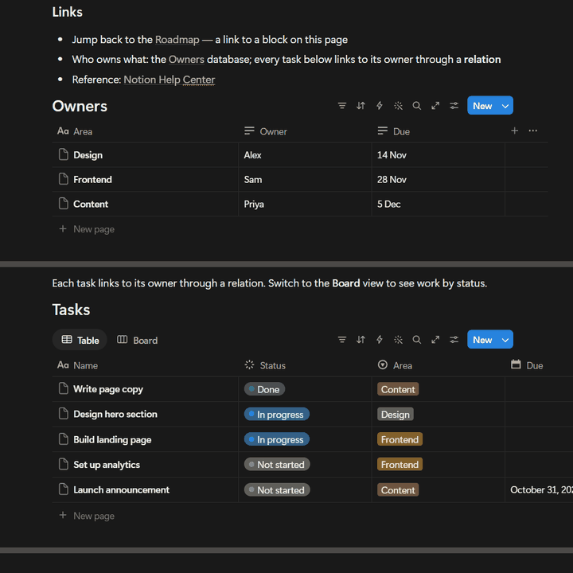
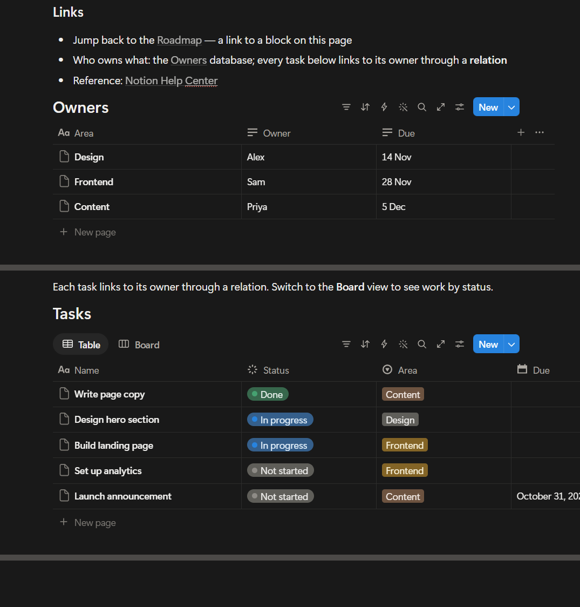
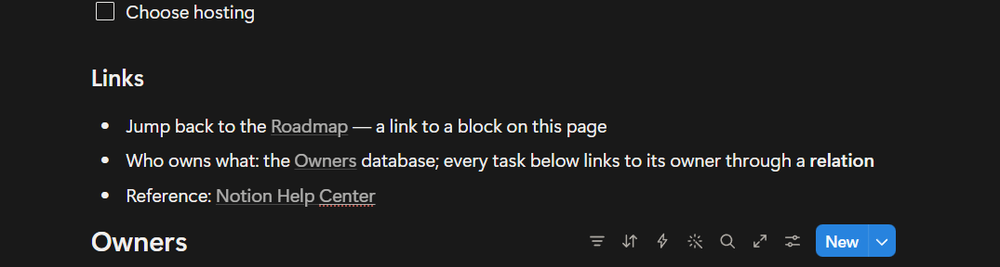
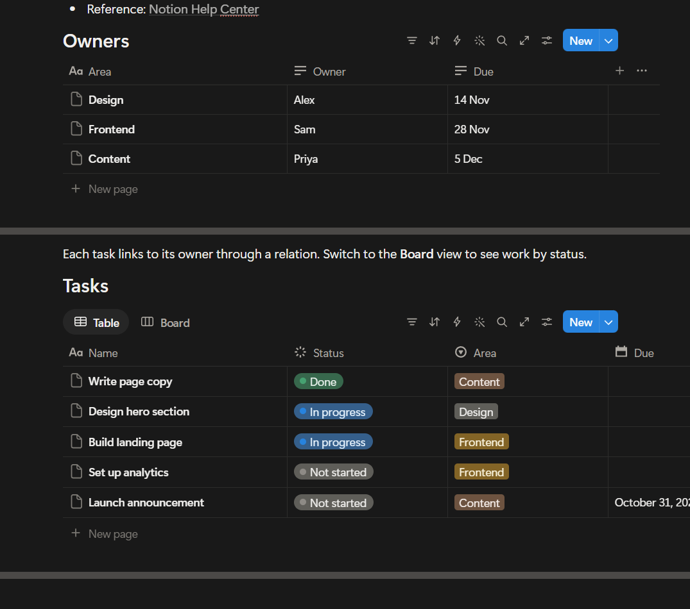
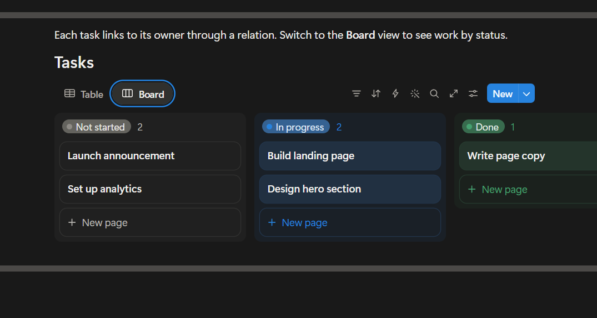
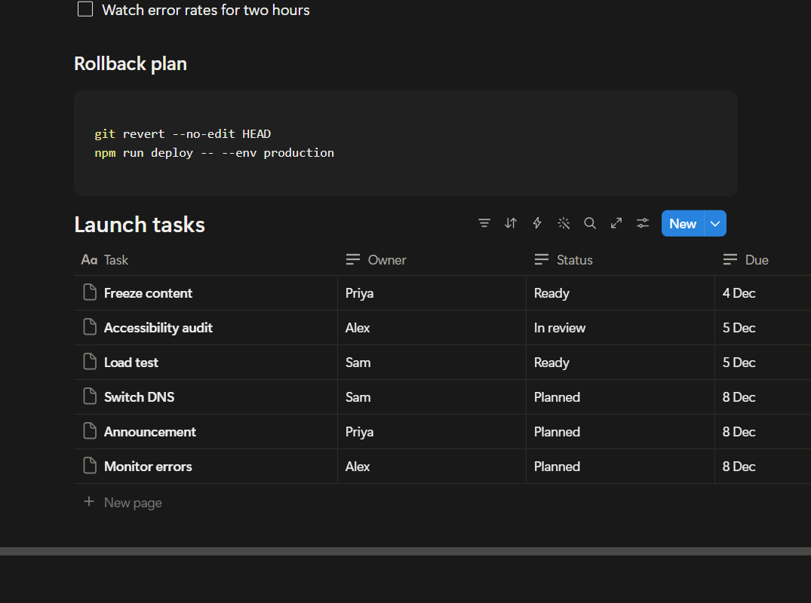
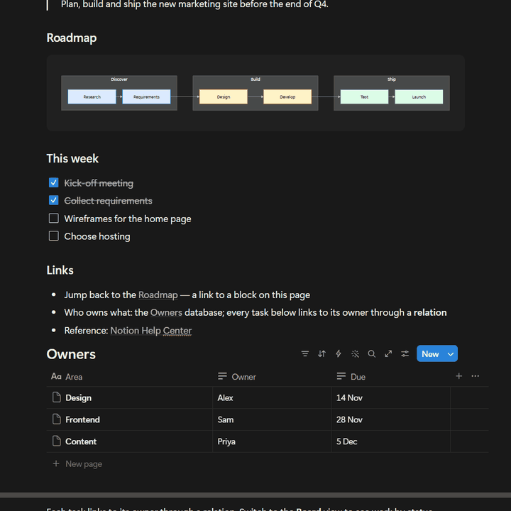

# Notion-Desktop-MCP

An MCP server that lets AI agents control the **Notion Desktop app** on your computer. It ships as a
Claude Code plugin and works with any other MCP client (Cursor, VS Code, Codex CLI, Gemini CLI and
others). It connects through Notion's **debug mode**. Notion starts with a remote debugging port
(`localhost:9222`), and the server drives the app over that port, the way browser automation tools
drive Chrome.

> ⚠️ **Use at your own risk.** An AI agent edits your real Notion content, and the debug port is open
> to local programs while it runs. Read [Disclaimer and risks](#disclaimer-and-risks) before you install.

## Why use it instead of the official Notion connector

| | Official Notion MCP / API | Notion-Desktop-MCP |
|---|---|---|
| Sign-in | OAuth or an integration token | **None.** Uses the Notion Desktop app you are already logged in to |
| Workspace admin | An owner or admin often has to approve or install the integration | **No admin step.** Nothing is installed in the workspace |
| Page access | Pages must be shared with the integration | **Every page you can open** in the app |
| Guest workspaces | Usually not reachable (guests cannot add integrations) | ✅ Works wherever you are a guest with edit access |
| Runs where | Notion's servers / API | Your own computer, against your local Notion Desktop |

In short: if Notion Desktop is logged in on your PC, the agent can work in it. It does not work with
Notion in a web browser.

Not needing approval is a technical fact, not permission. Your organisation's rules on automation and
AI tools still apply; see [Disclaimer and risks](#disclaimer-and-risks).



*Real recording. One `notion_insert` call writes a 12-block section (headings, numbered list, to-dos,
code). One `notion_create_database` call then builds a 6-row database. The calls took about 5 s and
11 s.*

---

## How it works

```
AI agent ──MCP──▶ notion-desktop-mcp server ──CDP──▶ Notion Desktop in debug mode (localhost:9222)
```

1. `notion_launch` restarts Notion Desktop with `--remote-debugging-port=9222`. Notion saves
   continuously, so the restart loses nothing.
2. The MCP server connects to that port with Playwright and exposes Notion-specific tools.
3. On connect, the server sends every client short usage and safety instructions. Claude Code also
   loads the full skill (`skills/notion-desktop-mcp/SKILL.md`).

Without debug mode the tools cannot connect. Switching Notion back to normal mode closes the port.

## Install

All installs need [Node.js](https://nodejs.org) 18 or newer and the Notion Desktop app. Pick the
section for your agent.

### Claude Code

```bash
claude plugin marketplace add felixhorobot/Notion-Desktop-MCP && claude plugin install notion-desktop-mcp@notion-desktop-mcp
```

The same two steps from inside Claude Code:

```
/plugin marketplace add felixhorobot/Notion-Desktop-MCP
/plugin install notion-desktop-mcp@notion-desktop-mcp
```

Restart Claude Code and ask it to **"start Notion in debug mode"**. Claude calls `notion_launch`. The
first start also installs the server's npm packages, which takes about 30 s.

<details>
<summary>Install from a clone, with desktop shortcuts (Windows)</summary>

```powershell
git clone https://github.com/felixhorobot/Notion-Desktop-MCP
cd Notion-Desktop-MCP
powershell -ExecutionPolicy Bypass -File install.ps1
```

The script installs the dependencies, registers the MCP server, links the skill into
`~/.claude/skills/notion-desktop-mcp`, and adds two desktop shortcuts: **Notion (Claude debug)** and
**Notion (normal)**. If you installed the plugin, run `install.ps1 -ShortcutsOnly` from a clone to get
only the shortcuts.
</details>

### Other AI agents

`npx` fetches the server from GitHub and runs it, so there is no separate download. Besides Node.js,
this needs [Git](https://git-scm.com).

```bash
npx -y github:felixhorobot/Notion-Desktop-MCP
```

Register that command as an MCP server in your client. One-line setup where the client has a command
for it:

| Client | Command |
|---|---|
| VS Code (Copilot agent mode) | `code --add-mcp "{\"name\":\"notion-desktop-mcp\",\"command\":\"npx\",\"args\":[\"-y\",\"github:felixhorobot/Notion-Desktop-MCP\"]}"` |
| Codex CLI | `codex mcp add notion-desktop-mcp -- npx -y github:felixhorobot/Notion-Desktop-MCP` |
| Gemini CLI | `gemini mcp add notion-desktop-mcp npx -y github:felixhorobot/Notion-Desktop-MCP` |

Clients configured with a JSON file (Cursor: `~/.cursor/mcp.json`; Windsurf:
`~/.codeium/windsurf/mcp_config.json`; Claude Desktop: `claude_desktop_config.json`) take this entry:

```json
{
  "mcpServers": {
    "notion-desktop-mcp": {
      "command": "npx",
      "args": ["-y", "github:felixhorobot/Notion-Desktop-MCP"]
    }
  }
}
```

On Windows, if a client cannot start `npx`, use `"command": "cmd"` with
`"args": ["/c", "npx", "-y", "github:felixhorobot/Notion-Desktop-MCP"]`.

Then ask the agent to start Notion in debug mode (`notion_launch`). Every client receives the server's
safety instructions on connect. For the full guide, add `skills/notion-desktop-mcp/SKILL.md` to the
agent's own instruction file (for example `AGENTS.md`, `GEMINI.md` or a Cursor rule).

Only Claude Code and the `npx` start have been tested. The client commands above follow each client's
documented MCP setup; please report any that do not work.

## Supported systems

| System | Status |
|---|---|
| **Windows 11** | ✅ Built and tested on Notion Desktop 7.41.1 (Microsoft Store version) |
| Windows 10 | 🟡 Same app and launcher; not tested |
| **macOS** | 🟡 **Not tested yet** (details below) |
| Linux | ❌ Notion has no official desktop app for Linux |

**macOS.** The server, relay and skill are plain Node.js and run on any system. Keyboard shortcuts use
Playwright's `ControlOrMeta`, which becomes ⌘ on a Mac. A Mac launcher, `launcher/notion.sh`, restarts
Notion with `--remote-debugging-port=9222`. Two points are still open:

1. Whether Notion Desktop for Mac accepts `--remote-debugging-port`. Most Electron apps do; some
   disable it.
2. Small differences in the Mac interface that could break a selector.

To check the first point, run `launcher/notion.sh debug` and then
`curl http://localhost:9222/json/version`. A JSON reply means debug mode works. Please open an issue
with your result.

## What it can do

### Write a whole section in one call

Headings, a quote, to-dos, a table and a horizontal Mermaid roadmap, all from one `notion_insert`.



### Links to blocks, databases and websites



### Related databases

`Owners` and `Tasks` are real Notion databases. Each task links to its owner through a relation, and
the Status and Area properties are filled in.



### Board views



### Create a database in one step

`notion_create_database` pastes a Markdown table and converts it to a database. The 6 × 4 table below
took one call. Filling the same cells one at a time takes about 1 s per cell.



### Delete with a backup, then restore

A delete only previews until you confirm it. Each deleted block is saved as Markdown first, and
`notion_restore_blocks` puts it back in the same place.



*The "This week" section is deleted, then restored to the same position with its ticks intact.*

## Tools

| Tool | What it does |
|---|---|
| `notion_launch` | Restart Notion Desktop in debug mode, or back to normal mode |
| `notion_status` | Connection, workspace, open tabs, access level |
| `notion_open` | Open a page by URL or id |
| `notion_outline` / `notion_read` | Every block with its id / the page as Markdown |
| `notion_insert` | Add Markdown as blocks; undoes its paste if an existing block disappears |
| `notion_create_database` | Build a database from a Markdown table in one step |
| `notion_delete_blocks` | Preview, then delete with `confirm:true`; saves a Markdown backup first |
| `notion_list_deletions` / `notion_restore_blocks` | List past deletes; put blocks back where they were |
| `notion_trash_page` / `notion_restore_page` | Move a page to Notion Trash and back, by URL or title |
| `notion_switch_workspace`, `notion_screenshot` | Switch workspace or account; take a screenshot |
| `notion_run_code` | Run Playwright code with the `page.n` helpers (views, filters, relations, formulas) |

The skill in `skills/notion-desktop-mcp/SKILL.md` covers the tools, Notion behaviour verified on the live
app, and the rules for shared workspaces.

## Safety

These rules are enforced by the server, not left to the prompt:

- Deleting blocks and trashing pages only preview until `confirm: true` is passed.
- In guest or shared workspaces, and whenever the server cannot identify the workspace, deletes are
  refused unless `allow_shared: true` is also passed. The server's instructions tell the agent to pass
  it only after you agree.
- Block backups are stored in `~/.notion-desktop-mcp/deletions.jsonl`. Restored blocks get new ids. Colours,
  the open or closed state of toggles, and code languages other than Mermaid are not kept.
- Child pages and databases go to Notion Trash, which keeps them for 30 days. `notion_restore_page`
  brings them back.
- Each insert compares the whole page before and after, scrolling to include blocks Notion has
  unloaded. If a block that existed before is missing, the insert undoes its own paste.

## Privacy

- Everything runs on your own computer. The project has no server, no telemetry and no analytics, and it
  sends nothing to the author or any third party.
- Notion content passes only between Notion Desktop and the AI agent you connect. What the agent does
  with it (for example, sending it to its model provider) is governed by that agent's own terms.
- Block backups are stored locally in `~/.notion-desktop-mcp/deletions.jsonl`. Delete that file at any
  time to remove them.

## Speed

- Send a whole section per `notion_insert`. It is one paste, whatever the number of blocks.
- Use `notion_create_database` for tables of data. It is one step instead of one action per cell.
- Per-cell edits (`n.db.setOption` and similar, through `notion_run_code`) take about 1 s each. Use
  them to set property types or fix single values.
- The server connects to Notion on the first call and stays connected, so later calls skip that step.

## Security

While Notion Desktop runs in debug mode, **any program on your computer** can connect to
`localhost:9222` and act as you in Notion, including reading your session. The port accepts local
connections only. Use debug mode on a computer you trust, and switch back to normal mode
(`notion_launch` with `mode: "normal"`) when you finish. `notion_run_code` runs any code you give it
against Notion; Claude Code asks for permission before running it unless you have allowed the tool.

## Disclaimer and risks

**You use this software at your own risk and are responsible for what it does in your Notion.**

- **Not official.** This is an independent project. It is not affiliated with, endorsed by or supported
  by Notion Labs, Inc. or Anthropic. "Notion" is a trademark of Notion Labs, Inc.
- **AI agents make mistakes.** An agent can edit, move or delete content you did not intend to change.
  The backup covers only blocks deleted through `notion_delete_blocks`. Edits to existing text, property
  changes and actions run through `notion_run_code` have no backup. Try it on a private test page first,
  review what the agent plans before it acts in shared workspaces, and rely on Notion's own page history
  and Trash for recovery.
- **Unofficial interface.** The server drives Notion's interface through a debugging port that Notion
  does not offer as an automation API. A Notion update can break it without notice.
- **Terms and policies.** Check that automating the Notion app is allowed under Notion's terms and under
  your organisation's or workspace's policies, especially for work and shared workspaces.
- **Local security.** While debug mode is on, other programs on your computer can control Notion (see
  [Security](#security)).
- **No warranty.** The software is provided "as is", without warranty of any kind, as stated in the
  [MIT License](LICENSE). The authors are not liable for data loss or any other damage from its use.

## Credit

Created by **[felixhorobot](https://github.com/felixhorobot)**. You may fork, change and reuse this
project under the MIT License. The license requires you to **keep the copyright notice**: keep the
`LICENSE` file and credit the original project, for example:

> Based on [Notion-Desktop-MCP](https://github.com/felixhorobot/Notion-Desktop-MCP) by felixhorobot.

## Development

```bash
npm install
node server/test/call.mjs                           # list the tools
node server/test/call.mjs notion_status '{}'        # call one tool
node server/test/roundtrip.mjs <scratch-page-url>   # delete/restore round trip on a page you own
```

`skills/notion-desktop-mcp/scripts/selftest.js` runs 22 checks on the `page.n` helpers; run it with
`notion_run_code` in a private workspace. The tools drive Notion's interface, so run both tests again
after each Notion update.

| Path | Contents |
|---|---|
| `server/index.mjs` | MCP server and tools |
| `server/relay.mjs` | Relay that hides Notion's unresponsive debug targets and keeps your theme |
| `server/start.mjs` | Entry point; installs dependencies on first run |
| `skills/notion-desktop-mcp/` | The skill: `SKILL.md`, reference notes, `page.n` helpers |
| `launcher/` | `notion.ps1` (Windows) and `notion.sh` (macOS) start Notion in debug or normal mode |

## License

[MIT](LICENSE) © felixhorobot
